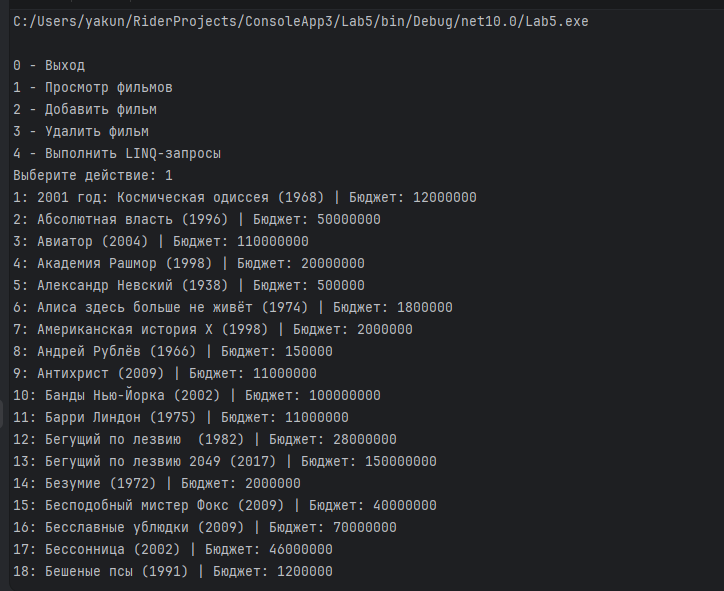
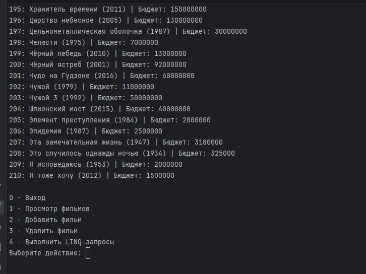
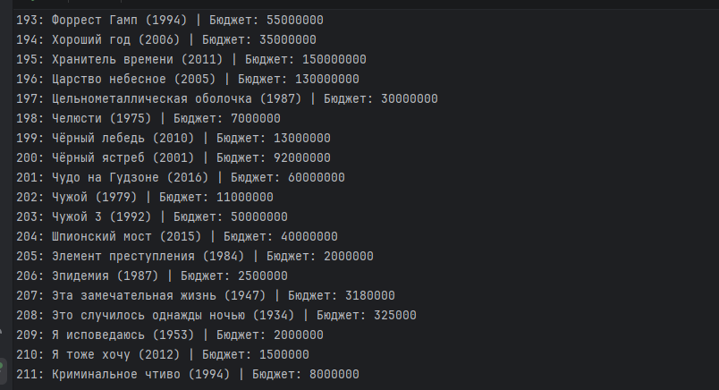
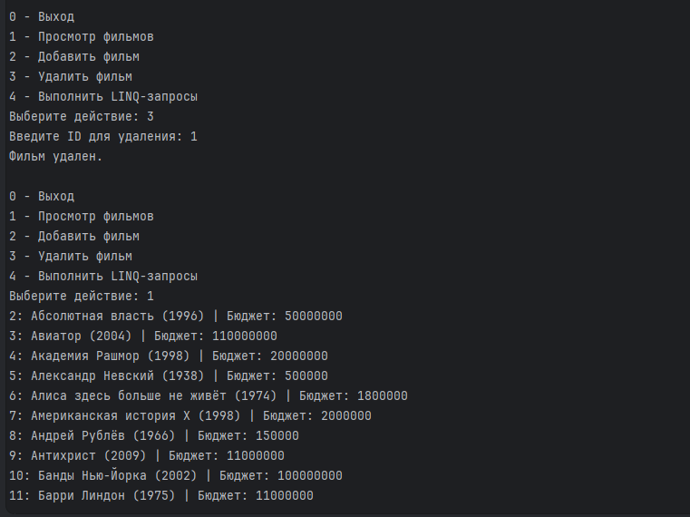
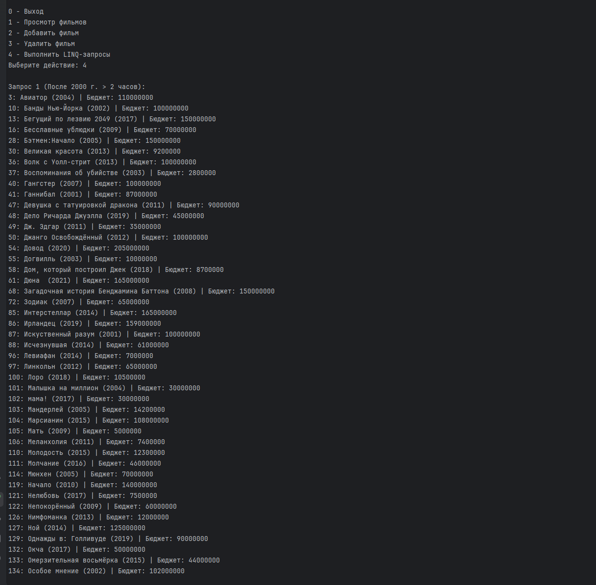
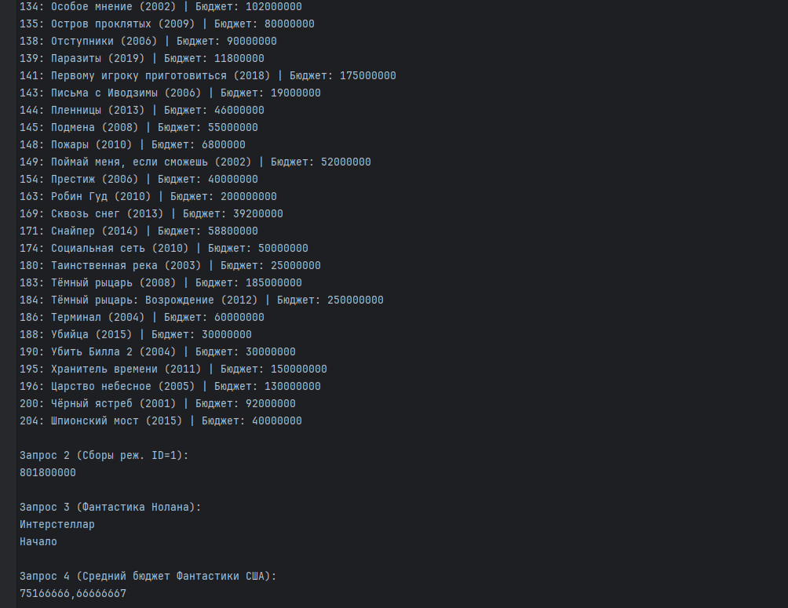

# Лабораторная работа №5

**Вариант:** 14  
**Тема:** Работа с базой фильмов, Excel и LINQ-запросами.

## Задача 1. Загрузка и просмотр базы фильмов

**Текст задачи:** Реализовать загрузку списка фильмов из файла Excel и вывод записей базы данных на экран.

**Алгоритм решения:**

1. Создать объект `ExcelManager`, указав файл `LR5-var14.xlsx`.
2. Считать данные с первого листа электронной таблицы. Первая строка содержит заголовки, поэтому чтение начинается со следующей строки.
3. Для каждой строки получить значения полей: ID фильма, название, ID режиссёра, год выхода, ID жанра, продолжительность, бюджет и сборы.
4. На основе полученных значений создать объект `Film` и добавить его в список.
5. При выборе пункта меню «Просмотр фильмов» перебрать список и вывести информацию о каждой записи.

**Тестирование:** Запущена программа и выбран пункт меню `1 — Просмотр фильмов`. Проверен вывод начала и конца списка, содержащего 210 фильмов.

## Задача 2. Добавление фильма

**Текст задачи:** Реализовать добавление новой записи о фильме с вводом её характеристик с клавиатуры и сохранением изменений в Excel-файл.

**Алгоритм решения:**

1. Выбрать в меню пункт `2 — Добавить фильм`.
2. Считать с клавиатуры ID, название, имя режиссёра, год выхода, название жанра, продолжительность, бюджет и сборы.
3. Найти режиссёра и жанр в соответствующих списках по введённым названиям без учёта регистра.
4. Создать объект `Film` и добавить его в список фильмов.
5. Вызвать сохранение списка в Excel-файл, чтобы внесённая запись сохранилась после завершения программы.

**Тестирование:** Добавлена запись со следующими данными:

- ID: `211`;
- название: `Криминальное чтиво`;
- режиссёр: `Квентин Тарантино`;
- год выхода: `1994`;
- жанр: `Криминал`;
- продолжительность: `9240`;
- бюджет: `8000000`;
- сборы: `213000000`.

После ввода данных программа вывела сообщение об успешном добавлении. При повторном просмотре списка добавленная запись появилась в конце.

## Задача 3. Удаление фильма

**Текст задачи:** Реализовать удаление фильма из базы данных по его ID с сохранением изменений в Excel-файл.

**Алгоритм решения:**

1. Выбрать в меню пункт `3 — Удалить фильм`.
2. Считать ID удаляемого фильма.
3. Найти запись с указанным ID и удалить её из списка.
4. Сохранить обновлённый список фильмов в Excel-файл.
5. Вывести сообщение об успешном удалении.

**Тестирование:** Для удаления введён ID `1`. Программа сообщила, что фильм удалён. После этого был выведен обновлённый список, начинающийся с записи с ID `2`, что подтверждает удаление первой записи.

## Задача 4. Выполнение LINQ-запросов

**Текст задачи:** Реализовать LINQ-запросы для выборки и анализа данных о фильмах, режиссёрах и жанрах.

**Алгоритм решения:**

1. **Запрос 1.** Отобрать фильмы, вышедшие после 2000 года, продолжительность которых превышает 7200 секунд (2 часа). Для фильтрации используется условие по году выхода и продолжительности.
2. **Запрос 2.** Соединить данные о фильмах и режиссёрах по ID режиссёра, отобрать фильмы режиссёра с ID `1` и вычислить сумму их кассовых сборов.
3. **Запрос 3.** Соединить фильмы со справочниками жанров и режиссёров. Вывести названия фильмов жанра `Фантастика`, снятых режиссёром `Кристофер Нолан`.
4. **Запрос 4.** Соединить фильмы со справочниками жанров и режиссёров, отобрать фантастические фильмы режиссёров из `США` и вычислить средний бюджет этих фильмов.

**Тестирование:** Запущен пункт меню `4 — Выполнить LINQ-запросы`. Получены следующие результаты:

- Запрос 1 вывел фильмы, выпущенные после 2000 года и продолжительностью более двух часов.
- Запрос 2: сумма сборов фильмов режиссёра с ID `1` — `8018000000`.
- Запрос 3: найдены фильмы `Интерстеллар` и `Начало`.
- Запрос 4: средний бюджет фантастических фильмов режиссёров из США — `75166666,66666667`.

Первый скриншот показывает результаты первого запроса, второй — продолжение списка и результаты запросов 2–4.

